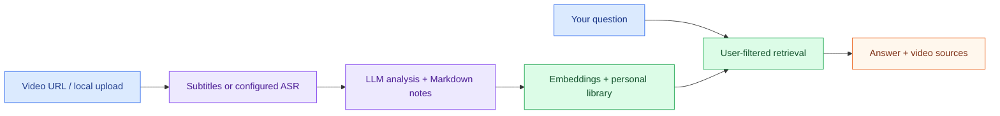
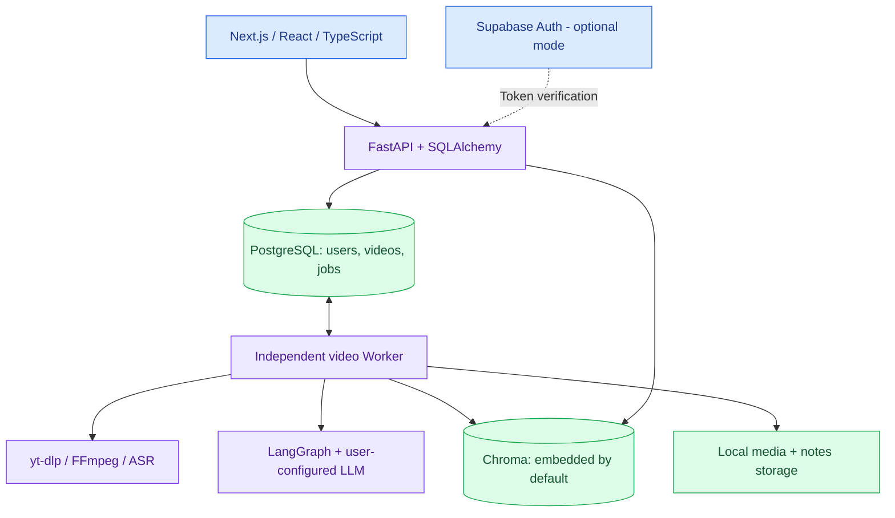

# VideoMind AI

**Turn saved videos into structured notes and a searchable personal knowledge library.**

**English** · [简体中文](README.zh-CN.md)

[](https://github.com/17-chen/videomind-ai/actions/workflows/ci.yml)


[Quick start](#quick-start) · [Features](#features) · [Architecture](#architecture) · [Project status](#project-status) · [Developer guide](#development-and-checks)

Save a video URL or upload a file, extract its subtitles or transcript, generate Markdown notes, and search your library through retrieval-augmented generation (RAG). Answers return video sources so you can revisit the material behind a response.

The application has a **Chinese/English interface**, a Next.js frontend, and a FastAPI backend. PostgreSQL stores library data and durable jobs; a separate Worker performs the video-processing stages.

> [!NOTE]
> This is an actively developed local application, not a production-ready hosted SaaS. The default demo account is shared, ASR is disabled by default, and `local_hash` embeddings are intended for workflow testing. Real Supabase users, paid-provider analysis/Q&A, and the complete real-video workflow still require acceptance testing.

## Features

| Capability | What is implemented |
| --- | --- |
| Video library | URL intake and local uploads; search, pagination, tags, and per-user categories |
| Transcription | Subtitle-first processing, audio extraction, optional local faster-whisper or the user's OpenAI transcription configuration |
| Structured notes | LangGraph analysis, summaries, editable Markdown, and index synchronization/retry |
| Chat with videos | User-filtered Chroma retrieval and source-linked answers using a configured LLM |
| Durable tasks | PostgreSQL queue, independent Worker, lease/heartbeat recovery, stage-boundary cancellation, and reuse of completed stages |
| Personal AI settings | DeepSeek/OpenAI configuration and encrypted user API keys; authenticated requests never fall back to the owner's key |
| Development operations | Readiness checks, request/task correlation, read-only queue snapshots, retrieval evaluation, and a recovery runbook |

These are implemented capabilities, not a claim that every external integration has passed real-service validation. See [project status](#project-status) for evidence.

## From video to knowledge



## Architecture



Jobs survive API restarts. Cancellation takes effect between stages, not during an external call. Operations that may already have incurred provider charges are not blindly repeated after an uncertain interruption. Embedded Chroma and local files remain a local-development setup; production persistence is unfinished.

## Quick start

### 1. Start the local application

Install Git and a working **Docker Engine with Compose v2**. Docker Desktop or configured Colima can be used. Host Node.js/Python installations are only needed for development outside containers.

```bash
git clone https://github.com/17-chen/videomind-ai.git
cd videomind-ai
cp .env.example .env
docker compose --profile app up -d --build
docker compose ps
```

This starts the application profile, including the backend, frontend, and **Worker**, plus PostgreSQL and Adminer. Backend startup applies the supplied migration flow. The default vector store is embedded; no separate Chroma container is required.

| Local service | Default address |
| --- | --- |
| Web application | `http://localhost:3000` |
| API documentation | `http://localhost:8000/docs` |
| Readiness | `http://localhost:8000/api/v1/health/ready` |
| Adminer | `http://localhost:8080` |

If port 8000 is occupied, set **both** `API_PORT=8001` and `NEXT_PUBLIC_API_BASE_URL=http://localhost:8001/api/v1` in your private `.env`, then recreate the application services. Keep `INTERNAL_API_BASE_URL=http://backend:8000/api/v1` for container-to-container access.

### 2. Understand the defaults

| Setting | Default | Meaning |
| --- | --- | --- |
| `AUTH_MODE` | `demo` | Visits share a development account; personal key writes are rejected |
| `ASR_PROVIDER` | `disabled` | Subtitles are preferred; subtitle-free videos need enabled ASR |
| `EMBEDDING_PROVIDER` | `local_hash` | Deterministic workflow vectors, not a semantic-quality benchmark |
| `CHROMA_MODE` | `embedded` | Vectors persist under `storage/chroma/` |
| `INSTALL_LOCAL_AI` | `false` | Large optional model dependencies are excluded from the default image |

You can inspect the interface in demo mode without a model key. AI notes and answers need an appropriate model configuration; cloning this repository does not provide inference credits.

### 3. Configure accounts and personal model keys

For a personal-user setup, configure a Supabase project in `.env`:

```dotenv
AUTH_MODE=supabase
SUPABASE_URL=https://your-project.supabase.co
SUPABASE_ANON_KEY=your-public-anon-key
NEXT_PUBLIC_SUPABASE_URL=https://your-project.supabase.co
NEXT_PUBLIC_SUPABASE_ANON_KEY=your-public-anon-key
USER_API_KEY_ENCRYPTION_KEY=your-persistent-fernet-key
```

Generate a Fernet key once, keep it private, and retain it with backups. After building the backend image, for example:

```bash
docker compose run --rm --no-deps backend python -c "from cryptography.fernet import Fernet; print(Fernet.generate_key().decode())"
```

Save the result in your private `.env`; do not commit it or regenerate it over an existing key. Recreate frontend/backend/Worker services after configuration changes. Sign in at `/auth`, then configure your own DeepSeek or OpenAI model/API key at `/settings`. The optional OpenAI transcription key is configured separately. Provider usage is billed to the key owner.

Frontend and backend must use the same Supabase project. This path has implementation and automated coverage, but real two-user acceptance is still pending. See the [recovery runbook (中文)](docs/RECOVERY_RUNBOOK.md) before handling stored encrypted keys.

### 4. Enable optional local AI

For subtitle-free transcription and Chinese semantic embeddings, set these in your private `.env`:

```dotenv
INSTALL_LOCAL_AI=true
ASR_PROVIDER=faster_whisper
LOCAL_WHISPER_MODEL=base
LOCAL_WHISPER_DEVICE=cpu
LOCAL_WHISPER_COMPUTE_TYPE=int8
EMBEDDING_PROVIDER=bge_zh
EMBEDDING_MODEL=BAAI/bge-small-zh-v1.5
```

Rebuild the backend image and recreate the Worker that uses it:

```bash
docker compose --profile app up -d --build backend
docker compose --profile app up -d --no-deps --force-recreate worker
```

First use downloads models. Local ASR/embeddings consume compute and disk; note generation and Q&A still use your configured LLM. Switching embedding models requires explicitly rebuilding existing indexes. Start with a read-only preview:

```bash
docker compose exec backend python -m scripts.reindex_vectors --dry-run
```

See the [local AI guide (中文)](docs/LOCAL_AI.md) for model isolation, index rebuilding, and compatibility limits.

## Use the application

1. Open `/library` to save a URL or upload a video.
2. In its detail page, start the complete workflow or run processing, analysis, and indexing separately.
3. Keep the Worker running. HTTP `202` means **queued**, not completed; the page shows task stages and cancellation status.
4. Review/edit Markdown notes, then use `/chat` to ask about indexed material and revisit the returned video sources.
5. Switch the interface with the Chinese/English control. Prompts and generated content have their own language behavior; changing the UI does not translate stored videos or notes.

Downloads depend on source-site access rules, network, subtitles, and yt-dlp support. Use media you are authorized to process.

## Project status

Evidence snapshot: **2026-10-27**. A narrow smoke test is not full product acceptance.

| Area | Evidence and remaining work |
| --- | --- |
| Automated checks | The [2026-10-27 record](docs/VERIFICATION_2026-10-27.md) reports 96 backend tests, Ruff, and passing backend/frontend CI. These are prior results, not tests rerun by this documentation update. |
| Real media/local ASR | An isolated NASA public-video download/transcription path has run through a real Worker; the full real-provider notes/index/Q&A chain is still awaiting validation. |
| Retrieval quality | Synthetic fixtures and a small NASA English corpus have been evaluated. Recorded BGE Recall@2 on the public-video text set was 72.73%, with known misses; this does not establish Chinese or answer-generation quality. |
| Accounts/user keys | Supabase/BYOK code and automated checks exist; real two-user login/isolation, paid calls, and recovery from real saved ciphertext still need validation. |
| Deployment | Local production-image checks exist. Public hosting, cloud persistence, full storage quotas, production alerting, and long-running multi-instance operation are unfinished. |

See [retrieval evaluation (中文)](docs/RETRIEVAL_EVALUATION.md), [current context (中文)](PROJECT_CONTEXT.md), and the [delivery plan (中文)](docs/COMPLETION_PLAN.md) for evidence and open tasks.

## Development and checks

The project keeps **Next.js + FastAPI + SQLAlchemy**. For host frontend development use Node.js 22 (matching CI); the backend targets Python 3.12.

```bash
# Backend checks in the running container
docker compose exec backend python -m pytest -q
docker compose exec backend ruff check app tests scripts
docker compose exec backend python -m scripts.evaluate_retrieval

# Read-only queue snapshot
docker compose exec backend python -m scripts.task_queue_status
```

For a separate frontend development checkout:

```bash
cd frontend
npm ci
npm run dev
```

In an isolated frontend copy, run `npm run build`, `npm run typecheck`, and `npm run lint`. Avoid production builds in a running development server's directory; see [AGENTS.md](AGENTS.md) and the [handoff (中文)](PROJECT_HANDOFF.md).

Stop the stack with `docker compose --profile app down`. Preserve the PostgreSQL volume, `storage/`, and encryption key when retaining data. Do not delete volumes as a reset shortcut.

## Repository map and documentation

| Path | Purpose |
| --- | --- |
| [`frontend/`](frontend/) | Next.js pages, bilingual UI, API clients, and settings |
| [`backend/app/`](backend/app/) | FastAPI, agents, services, models, and contracts |
| [`backend/alembic/`](backend/alembic/) | Database migrations |
| [`backend/scripts/`](backend/scripts/) | Worker, evaluation, index and recovery utilities |
| [`backend/tests/`](backend/tests/) · [`backend/evals/`](backend/evals/) | Tests, fixed corpora, and evaluation reports |
| `storage/` | Runtime media, notes, vectors, and model cache; not public project data |
| [`docs/`](docs/) | Architecture, dated verification, recovery, and delivery plans |

- [中文首页](README.zh-CN.md)
- [Project document index (中文)](docs/PROJECT_MATERIALS.md)
- [Architecture (中文)](docs/architecture.md)
- [Recovery runbook (中文)](docs/RECOVERY_RUNBOOK.md)
- [Changelog](CHANGELOG.md) · [Open tasks (中文)](TODO.md)
- [Previous README, historical reference (中文)](docs/archive/README.before-bilingual.zh-CN.md)

The overview is maintained in English and Chinese. Deeper engineering records are currently primarily Chinese and are labeled accordingly. Bug reports and documentation improvements in either language are welcome.
