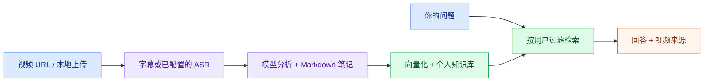
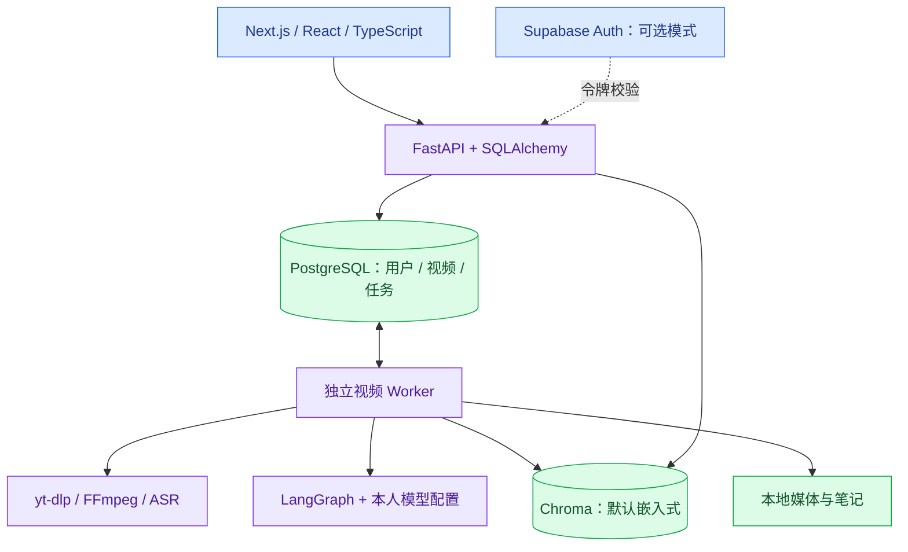

# VideoMind AI

**把收藏的视频转成结构化笔记与可检索、可追溯来源的个人知识库。**

[English](README.md) · **简体中文**

[](https://github.com/17-chen/videomind-ai/actions/workflows/ci.yml)


[快速开始](#快速开始) · [核心功能](#核心功能) · [系统架构](#系统架构) · [项目状态](#项目状态) · [开发与检查](#开发与检查)

保存视频链接或上传文件，获取字幕/转写，生成 Markdown 笔记，再通过 RAG（检索增强生成）向个人视频资料提问。回答返回视频来源，方便回到原始材料核对。

应用提供**中英文界面**，前端使用 Next.js，后端使用 FastAPI。PostgreSQL 保存资料和持久任务，独立 Worker 执行视频处理各阶段。

> [!NOTE]
> 项目处于本地开发阶段，尚非正式托管 SaaS。默认 demo 用户由所有访问者共用，ASR 默认关闭，`local_hash` 向量用于流程验证。真实 Supabase 用户、付费分析/问答与真实视频完整闭环仍待验收。

## 核心功能

| 能力 | 已有实现 |
| --- | --- |
| 视频知识库 | URL 和本地上传；搜索、分页、标签及本人分类 |
| 转写 | 优先字幕、音频提取、可选本地 faster-whisper 或本人 OpenAI 转写配置 |
| 结构化笔记 | LangGraph 分析、摘要、可编辑 Markdown、索引同步与重试 |
| 视频问答 | Chroma 按用户过滤检索，使用配置的模型回答并返回来源 |
| 持久任务 | PostgreSQL 队列、独立 Worker、租约/心跳恢复、阶段边界取消、复用已完成步骤 |
| 个人 AI 设置 | DeepSeek/OpenAI 配置、用户 Key 加密存储；认证用户缺 Key 不回退到所有者密钥 |
| 开发运维 | readiness、请求/任务关联日志、只读队列快照、检索评测、恢复手册 |

以上表示代码能力已经实现，不代表所有外部集成都完成真实服务验收。证据见下方项目状态。

## 从视频到知识



## 系统架构



任务跨 API 重启保留。取消在阶段边界生效，不能中断在途外部调用；可能已计费但结果尚未确认落库的阶段不会盲目重做。嵌入式 Chroma 和本地文件仍是本地开发方案，生产持久化尚未收束。

## 快速开始

### 1. 启动本地应用

需要 Git 和可用的 **Docker Engine / Compose v2**；Docker Desktop 或已配置的 Colima 均可。容器外开发才需要宿主 Node.js / Python。

```bash
git clone https://github.com/17-chen/videomind-ai.git
cd videomind-ai
cp .env.example .env
docker compose --profile app up -d --build
docker compose ps
```

命令包含 backend、frontend、**Worker**，以及 PostgreSQL 和 Adminer；后端启动使用仓库迁移流程。默认 Chroma 嵌入后端，无需单独启动 Chroma 容器。

| 服务 | 默认地址 |
| --- | --- |
| 网页 | `http://localhost:3000` |
| API 文档 | `http://localhost:8000/docs` |
| 就绪检查 | `http://localhost:8000/api/v1/health/ready` |
| Adminer | `http://localhost:8080` |

8000 端口被占用时，在私有 `.env` 中同时设置 `API_PORT=8001`、`NEXT_PUBLIC_API_BASE_URL=http://localhost:8001/api/v1`，再重建应用服务。容器内 `INTERNAL_API_BASE_URL` 保持 `http://backend:8000/api/v1`。

### 2. 理解默认配置

| 配置 | 默认值 | 含义 |
| --- | --- | --- |
| `AUTH_MODE` | `demo` | 共用开发账户，拒绝保存个人密钥 |
| `ASR_PROVIDER` | `disabled` | 优先字幕，无字幕时需要启用转写 |
| `EMBEDDING_PROVIDER` | `local_hash` | 确定性流程测试向量，不代表语义检索达标 |
| `CHROMA_MODE` | `embedded` | 向量保存在 `storage/chroma/` |
| `INSTALL_LOCAL_AI` | `false` | 默认镜像不含大型可选模型依赖 |

可以不填模型 Key 预览界面；AI 笔记、问答需要模型配置。克隆仓库不会提供推理额度。

### 3. 配置账户与本人模型密钥

使用个人账户时，在 `.env` 配置自己的 Supabase 项目：

```dotenv
AUTH_MODE=supabase
SUPABASE_URL=https://your-project.supabase.co
SUPABASE_ANON_KEY=your-public-anon-key
NEXT_PUBLIC_SUPABASE_URL=https://your-project.supabase.co
NEXT_PUBLIC_SUPABASE_ANON_KEY=your-public-anon-key
USER_API_KEY_ENCRYPTION_KEY=your-persistent-fernet-key
```

Fernet 主密钥只生成一次，私下保存并随备份保留。后端镜像构建完成后可运行：

```bash
docker compose run --rm --no-deps backend python -c "from cryptography.fernet import Fernet; print(Fernet.generate_key().decode())"
```

把结果存入私有 `.env`，不要提交或覆盖已有主密钥。修改后重建 frontend/backend/Worker 服务。在 `/auth` 登录，再到 `/settings` 配置自己的 DeepSeek 或 OpenAI 模型、API Key；转写 Key 另填，费用由密钥所有者承担。

前后端必须指向同一 Supabase 项目；该路径有实现和自动化覆盖，真实双用户验收仍待完成。处理已保存密钥前，先看 [恢复手册](docs/RECOVERY_RUNBOOK.md)。

### 4. 可选本地 AI

无字幕转写和中文语义向量可配置为：

```dotenv
INSTALL_LOCAL_AI=true
ASR_PROVIDER=faster_whisper
LOCAL_WHISPER_MODEL=base
LOCAL_WHISPER_DEVICE=cpu
LOCAL_WHISPER_COMPUTE_TYPE=int8
EMBEDDING_PROVIDER=bge_zh
EMBEDDING_MODEL=BAAI/bge-small-zh-v1.5
```

重新构建 backend，并重建使用该镜像的 Worker：

```bash
docker compose --profile app up -d --build backend
docker compose --profile app up -d --no-deps --force-recreate worker
```

首次使用需下载模型、消耗本机算力与磁盘；笔记、问答仍使用配置的 LLM。切换向量模型后需显式重建旧资料索引，先运行只读预检查：

```bash
docker compose exec backend python -m scripts.reindex_vectors --dry-run
```

模型隔离、实际重建和依赖兼容见 [本地 AI 配置](docs/LOCAL_AI.md)。

## 使用流程

1. 在 `/library` 保存 URL 或上传视频。
2. 在详情页启动完整流程，或分别处理字幕、分析、入库。
3. 保持 Worker 运行；HTTP `202` 表示**已入队**，不是已完成，页面显示阶段和取消状态。
4. 查看/编辑笔记，再到 `/chat` 提问并核对返回的视频来源。
5. 使用中英文界面开关；提示词和生成内容有各自语言行为，切换界面不会自动翻译已有视频与笔记。

下载受平台权限、网络、字幕与 yt-dlp 支持情况影响，请使用有权处理的媒体。

## 项目状态

证据快照：**2026-10-27**。单项烟测不等于完整产品验收。

| 项目 | 已有证据与剩余工作 |
| --- | --- |
| 自动化检查 | [2026-10-27 核查](docs/VERIFICATION_2026-10-27.md) 记录后端 96 项测试、Ruff 和前后端 CI 通过；是此前结果，本次文档修改没有重跑业务测试。 |
| 真实媒体/本地 ASR | 独立 Worker 已跑通隔离 NASA 公开视频下载、转写；本人模型下的真实笔记、入库、问答完整链路仍待验收。 |
| 检索质量 | 已评测虚构语料和小型 NASA 英文文本集；后者 BGE Recall@2 为 72.73%，保留漏检，不能推断中文或生成回答达标。 |
| 账户/密钥 | Supabase/BYOK 代码及自动化检查已有；真实双用户登录/隔离、付费调用和真实用户密文恢复仍待验证。 |
| 部署 | 已有本地生产镜像检查；公开托管、云端持久化、完整存储配额、生产告警、多实例长期运行尚未完成。 |

详细证据与计划见 [检索评测](docs/RETRIEVAL_EVALUATION.md)、[项目上下文](PROJECT_CONTEXT.md)、[剩余交付计划](docs/COMPLETION_PLAN.md)。

## 开发与检查

保留 **Next.js + FastAPI + SQLAlchemy** 架构；宿主前端开发使用与 CI 相同的 Node.js 22，后端目标为 Python 3.12。

```bash
# 运行中后端容器的检查
docker compose exec backend python -m pytest -q
docker compose exec backend ruff check app tests scripts
docker compose exec backend python -m scripts.evaluate_retrieval

# 只读任务队列快照
docker compose exec backend python -m scripts.task_queue_status
```

独立前端开发检出目录可运行：

```bash
cd frontend
npm ci
npm run dev
```

在隔离副本执行 `npm run build`、`npm run typecheck`、`npm run lint`。不要在正在运行 dev 服务的目录执行生产构建，见 [AGENTS.md](AGENTS.md)、[项目交接](PROJECT_HANDOFF.md)。

停止应用使用 `docker compose --profile app down`；保留数据时应保留 PostgreSQL 卷、`storage/` 与主密钥，不通过删除卷排错。

## 仓库结构与文档

| 路径 | 用途 |
| --- | --- |
| [`frontend/`](frontend/) | Next.js 页面、中英文界面、API、用户设置 |
| [`backend/app/`](backend/app/) | FastAPI、Agent、服务、模型、协议 |
| [`backend/alembic/`](backend/alembic/) | 数据库迁移 |
| [`backend/scripts/`](backend/scripts/) | Worker、评测、索引、恢复工具 |
| [`backend/tests/`](backend/tests/) · [`backend/evals/`](backend/evals/) | 测试、固定语料、评测报告 |
| `storage/` | 本地媒体、笔记、向量、模型缓存，不是公开资料 |
| [`docs/`](docs/) | 架构、日期核查、恢复、交付计划 |

- [English overview](README.md)
- [项目资料入口](docs/PROJECT_MATERIALS.md)
- [系统架构](docs/architecture.md)
- [恢复与备份手册](docs/RECOVERY_RUNBOOK.md)
- [变更记录](CHANGELOG.md) · [待办](TODO.md)
- [此前 README 历史存档](docs/archive/README.before-bilingual.zh-CN.md)

两份首页维护中英文版本；更深入的工程记录仍主要为中文，英文首页已标注其语言。欢迎中英文反馈和文档改进。
